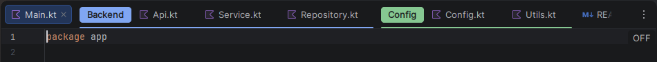
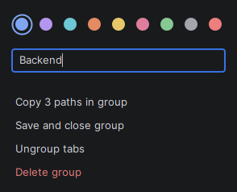

# IntelliJ Editor Tab Groups

Named, colored, collapsible groups for editor tabs in IntelliJ-based IDEs.

## Usage

- Right-click a tab and choose **Add Tab to New Group**, or **Add Tab to Group** to join an existing one.
- Click a group's label to collapse or expand it. Collapsed tabs stay open.
- Drag tabs into or out of a group, or drag the label to move the whole group.
- Right-click the label to rename, recolor, ungroup, save and close, or delete the group.
- Reopen a saved group from **Reopen Saved Tab Group** in the tab context menu.

## Installation

In the IDE, open **Settings > Plugins > Marketplace** and search for "Editor Tab Groups".

## License

[Apache License 2.0](LICENSE)
